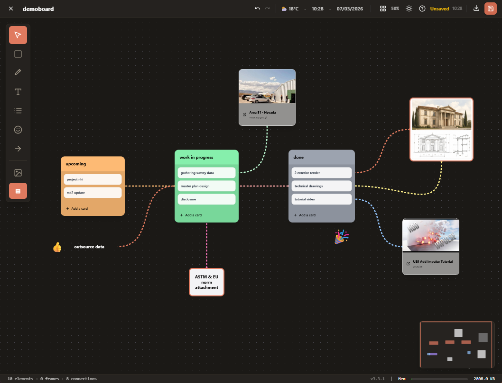

# Utku Board

**A single-file infinite canvas whiteboard.** No install, no server, no account — just open one HTML file in your browser.

**[▶ Try it live](https://keemlanbou.github.io/utkuboard/)** · [Download](https://github.com/keemlanbou/utkuboard/releases) · [Watch the demo](https://youtu.be/Ak81a9eJCTM)

## Why

Most whiteboard apps need an account, a subscription, or an internet connection. Utku Board is one ~235 KB HTML file. Your projects are saved as local `.utkuboard` files on your own disk — nothing is uploaded anywhere.

## Features

- **Infinite canvas** with dot grid, pan (right-click / middle-click drag) and zoom (scroll)
- **Tools**: shapes (rect / circle / triangle), pen with color & width, text, emoji stickers (40), arrows with auto port-snap, images (drag & drop or paste)
- **Board cards** (Trello-style): drag & drop tasks between cards, multi-line tasks, header images — and every task has its own **output port** for node-graph workflows
- **Connections**: drag port-to-port; click a line to cycle curved / straight / electric; right-click to toggle flow animation; middle-click (Mac: `Option`+click) to cycle its color
- **Reroute nodes**: double-click a line to add a movable dot, then drag from its sides to branch as many wires as you like (Unreal Blueprint style)
- **Connection knife**: hold `Shift` and drag across lines to cut them (Unreal Engine style)
- **Alt+drag a port** to transfer *all* its connections to another node at once
- **AutoCAD-style selection**: drag left→right = blue window (fully contained), right→left = green crossing (touch)
- **Isolation mode** (`Alt+Q`): fade everything except your selection, like 3ds Max
- **Frames & groups** (`C`, `Ctrl+G`), alignment (`Q` / `E`), distribution (`Shift+Q` / `Shift+E`), z-order (`[` / `]`), lock (`L`)
- **Links on anything**: right-click → Insert Link on shapes, text, images; double-click opens it; links stay **clickable in exported PDFs**
- **Copy / cut / paste** (`Ctrl+C` / `X` / `V`) with wires included, even between boards and tabs; paste images, links or plain text from other apps
- **One-click save** (Chrome / Edge): after the first save, `Ctrl+S` writes straight back to the same file; `Ctrl+Shift+S` = Save As
- **Export**: PNG, JPG, SVG, PDF — grid included
- **60 fps** even on large boards (GPU-accelerated dragging, zero re-renders while moving)
- Dark / light theme, weather & clock, autosave, full undo/redo (`Ctrl+Z`), `Esc` always returns to the Select tool

Press `?` inside the app for the complete shortcut list.

## Quick start

1. Download the latest `utkuboard_vX.X.X.html` from [Releases](https://github.com/keemlanbou/utkuboard/releases) (or just use the [live version](https://keemlanbou.github.io/utkuboard/))
2. Open it in Chrome / Edge (best — one-click save) or Firefox / Safari (each save downloads a new copy)
3. Create a project, build your board, `Ctrl+S` to save it as a `.utkuboard` file

## Privacy

Everything you create stays on your machine — projects, images, and text are stored inside your local `.utkuboard` file, never uploaded. The app makes three kinds of optional outbound requests: CDN libraries on first load (pinned versions with integrity hashes), a weather API for the clock bar, and link-preview metadata when you paste a URL. That's it.

## Tech

Single HTML file. React 18 + Tailwind via CDN (SRI-pinned), direct-DOM RAF rendering for drag performance, `html-to-image` + `jsPDF` for exports. Built iteratively with the help of Claude (Anthropic).

## Support

If Utku Board is useful to you, you can [buy me a coffee via PayPal](https://paypal.me/utkuboard) ☕

## License

[MIT](LICENSE) — © 2026 Utku Demir
